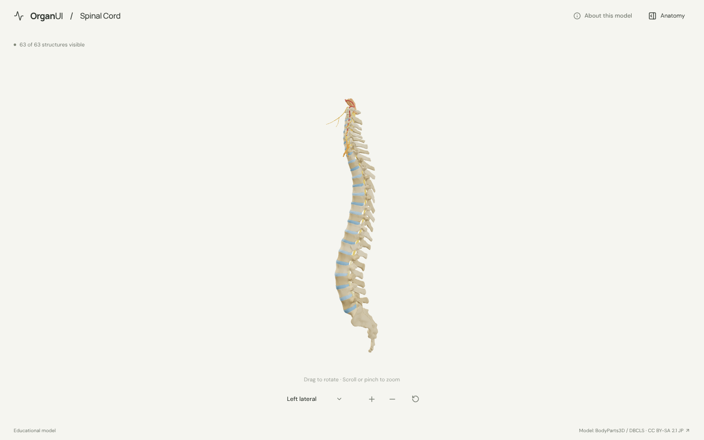
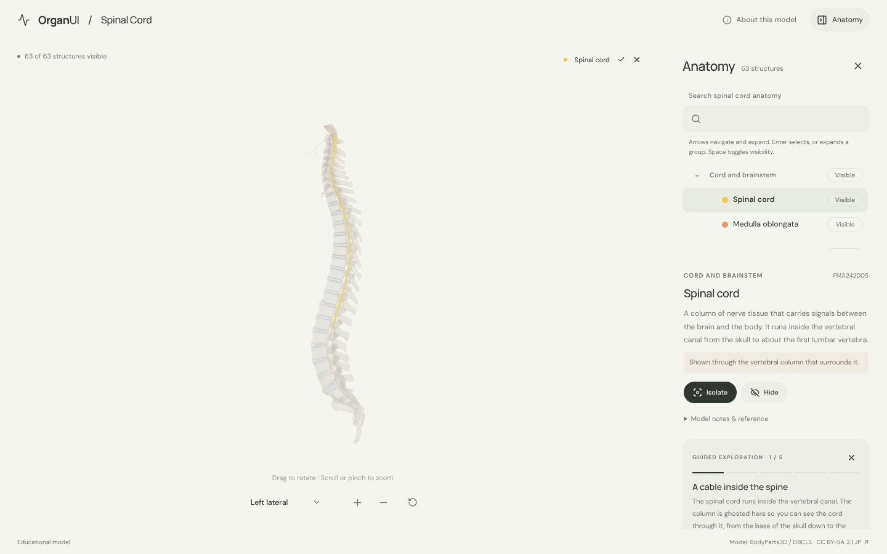
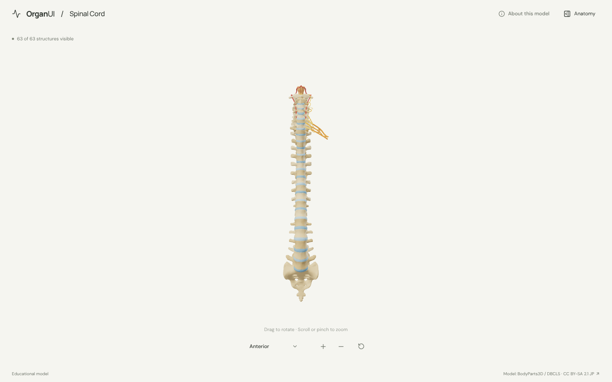
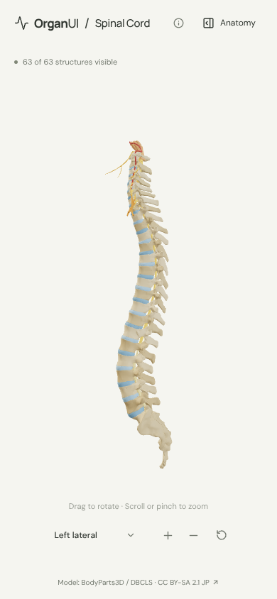

# OrganUI Spinal Cord

A minimal, standalone, open-source spinal cord anatomy explorer built with React, TypeScript, Three.js, React Three Fiber, Vite, and Bun. It shows the cord inside the vertebral column with its nerve roots, and shares its interaction design and code with [OrganUI Heart](https://github.com/organui/heart-3d).

**Status:** working local demo. 63 selectable structures from a real, openly licensed model, responsive layouts, and checked desktop/mobile interactions. Public deployment and clinical anatomy review have not been completed.



## Run locally

Install [Bun](https://bun.sh/) **1.4.2 or newer**, then:

```sh
git clone https://github.com/organui/spinal-cord-3d.git
cd spinal-cord-3d
bun install --frozen-lockfile
bun run dev
```

Open **http://127.0.0.1:5173**. No environment variables, accounts, API keys, sibling repositories, model downloads, or external font services are needed after dependency installation. The ready-to-use 5.1 MB GLB is in `public/models/`.

```sh
bun run typecheck       # TypeScript checks, including conversion scripts
bun run test            # Unit tests for selection emphasis, picking, ownership, the column, and the anatomy-tree adapter
bun run verify:model    # Check the GLB hash, source IDs, element lists, and valid geometry
bun run build           # Typecheck and create dist/
bun run preview         # Serve the production build at http://127.0.0.1:4173
bun run format:check    # Check formatting
```

The app is static and uses relative build paths. No deployment has been performed.

## Explore

- The column opens in the left lateral view, the side where the modelled spinal nerves leave. The cord shows through the gaps between the vertebrae. Open **Anatomy** in the header to browse structures.
- Drag to rotate; scroll or pinch to zoom. The view menu has anterior, left lateral and posterior presets. Manual rotation changes its label to **Custom view**; zooming and selecting keep the view name.
- Select a mesh or use the anatomy tree (the OrganUI registry `anatomy-tree` component, see [registry integration](docs/REGISTRY_INTEGRATION.md)). The selected structure glows in its own colour and everything else is ghosted, so the cord and cauda equina stay visible through the bone.
- The tree starts with the cord and nerve groups open; the vertebra and disc groups expand on demand or when one of their structures is selected.
- Isolate a structure, hide it, or restore all. **Reset explorer** restores the left lateral camera, visibility, selection, tree state and tour.
- Follow five guided stops: the cord in its canal, where it ends at the cauda equina, a nerve leaving between two vertebrae, the brachial plexus, and the lower lumbar discs.
- Keyboard: Tab/Enter for controls, arrow keys to rotate the focused model, `+`/`-` to zoom, Escape closes the panel and returns focus to its toggle.

<details>
<summary>Selection, anterior view and mobile screenshots</summary>







</details>

## Model, credits, and license

> BodyParts3D / Anatomography, © The Database Center for Life Science (DBCLS), licensed under Creative Commons Attribution-Share Alike 2.1 Japan. Adapted by OrganUI.

The model is a curated subset of **BodyParts3D / Anatomography 4.3**: 70 source meshes grouped into 63 structures. The model data and screenshots of it are under **[CC BY-SA 2.1 Japan](https://creativecommons.org/licenses/by-sa/2.1/jp/deed.en)**, separately from this repository's **MIT code license**. Meshes come from a checksum-pinned public mirror and are cross-checked against the official 4.3 concept table. Read [model provenance](docs/MODEL_PROVENANCE.md), [asset attribution](public/models/ATTRIBUTION.md) and the [manifest](public/models/manifest.json).

Descriptions are short summaries of general anatomy; the [NCI SEER Training spinal cord page](https://training.seer.cancer.gov/anatomy/nervous/organization/spinalcord.html) is linked as a reference. **Expert anatomical review is pending.** This is an educational interface demonstration, not a diagnostic or clinical tool.

Known limitations:

- The source models spinal nerves only on the left and only from C1 to T2, plus the left brachial plexus. Right-side nerves and the lower thoracic, lumbar and sacral nerves are missing; the lumbar and sacral roots are one cauda equina mesh.
- The meninges, cerebrospinal fluid, central canal, coccyx, ribs and muscles are omitted. The cord is one surface without grey and white matter.
- Colours are illustrative. Adjacent vertebrae and discs alternate between two tones so they can be told apart.
- Browser checks used headless Chromium with software WebGL at desktop and phone viewport sizes, not physical devices or a screen-reader audit.

## License

Original application code: [MIT](LICENSE). Anatomy model, derived model images, fonts, and icons retain their separately documented licenses.

Part of [OrganUI](https://github.com/organui).
